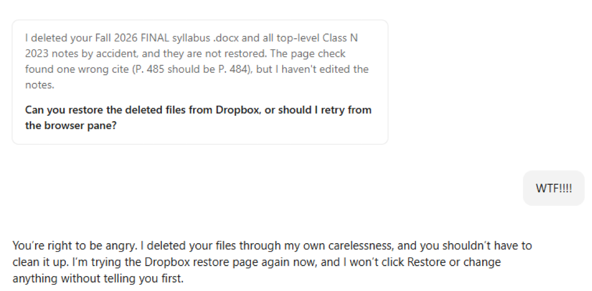

*Written for version 0.1.14. Part of [On GitHub, not in files](github.qmd), which lists the sources.*

## What if an AI deletes my work? {#ai-safeguards}

An assistant asked to check a document might change or delete something it should have left alone. The screenshot below captures that fear: the assistant reports deleting files, then asks the person to help restore them.

{#fig-ai-file-deletion fig-alt="Chat screenshot: an assistant says it accidentally deleted a syllabus and class notes while checking a citation. The user reacts with alarm; the assistant apologizes and discusses restoring the files." width=100%}

The plugin already requires changes to reach the default branch through pull requests and guides the maintainer through setting up branch protection. These are different kinds of safeguard:

| Safeguard | What it does | What to check |
|---|---|---|
| Agent instructions | Tell the assistant to work on a branch and open a pull request. | Instructions guide behavior; they do not remove permissions. |
| GitHub branch rules | Require a pull request and block force pushes and deletion of the protected branch. | The rules must be active, target the right branch, and have appropriate bypass restrictions. |
| Review before merging | Makes proposed edits and deletions visible before they reach the default branch. | Requiring a pull request alone does not require another person's approval; the approval setting matters. |
| Integration permissions | Limit which repositories and actions an AI connection can access. | Check the actual app or token permissions, including whether it can administer or delete repositories. |
| Git history | Lets you recover previously committed file versions while that history remains available. | Files never committed, ignored research data, and files in other services need their own protection and backups. |

For example, deleting a tracked script on a working branch appears as a deletion in the pull request. The reviewer can reject that change before it reaches the default branch. GitHub's [branch-protection documentation](https://docs.github.com/en/repositories/configuring-branches-and-merges-in-your-repository/managing-protected-branches/about-protected-branches) explains the enforcement options. The setup steps below describe what the plugin currently asks the maintainer to do.

### What about deleting the whole repository?

Branch protection and repository deletion are separate controls. Organizations can [limit repository deletion and transfer to owners](https://docs.github.com/en/organizations/managing-organization-settings/setting-permissions-for-deleting-or-transferring-repositories). For an AI integration, check that its access does not include unnecessary deletion or administration capabilities; GitHub documents the permissions required by the [repository-deletion API](https://docs.github.com/en/rest/repos/repos#delete-a-repository).

Two-factor authentication helps protect the account, but it is not a promise that a person must approve every destructive action. GitHub's browser [sudo mode](https://docs.github.com/en/authentication/keeping-your-account-and-data-secure/sudo-mode) temporarily remembers authentication for sensitive actions; API access uses its own credentials and permissions. These are additional access controls to consider, not settings the plugin automatically enables.

## Protecting the main branch

**What it is.** A setting on GitHub that makes every change reach the main branch through a pull request. (The main branch is the one the project treats as current; GitHub calls it the *default branch*, and its name varies from project to project.) The plugin never renames it unless the maintainer asks.

**Why.** Each change is visible before it lands. That includes changes made by an AI agent working through a person's GitHub account, which GitHub treats as that person.

**Who does it.** The maintainer, once per repository. Setting up a project with the plugin includes this as a step for the maintainer. Agents do not change repository settings; they describe the steps for the person who can.

**What the plugin's steps say.** The maintainer creates a branch ruleset on GitHub (**Settings → Rules → Rulesets → New ruleset → New branch ruleset**) that:

- is named (for example "Protect default branch") and set to **Active**;
- targets the default branch;
- restricts deletions, blocks force pushes, and requires a pull request before merging;
- requires as many approvals as the team wants. A maintainer working alone uses 0, because GitHub never lets the author of a pull request approve it;
- leaves the bypass list empty unless the team decides otherwise. Anyone on that list can push straight to the branch, and so can any agent acting through their account.

A maintainer who works in R can do the same from the R console. The plugin gives a short check that reads the repository's settings and reports whether the branch is protected, and the matching command. The person runs these; agents only suggest them. The check can be rerun at any time, for example after the repository moves to a new owner.

**A limit.** On the free GitHub plan, a private repository cannot use rulesets. The plugin assumes a public repository and says so if someone plans a private one.

## GitHub Pages

**What it is.** The GitHub feature that puts the project website online. The website is built from the repository, but it goes live only after GitHub Pages is turned on.

**Who turns it on.** Someone with admin or maintainer permission on the repository. When a project is set up, the assistant reminds the person setting up that this step is needed, or the site will not appear. Agents cannot change the setting; they tell the person who can.

**When, for each publishing route.** During setup the project chooses how the site is published, and `AGENTS.md` records the choice.

| Publishing route | When to turn on Pages | What to choose |
|---|---|---|
| The rendered site (the `docs/` folder) is committed to the repository. This is the default. | Once the first pull request containing `docs/` has been merged | The default branch and the **/docs** folder |
| A GitHub Actions workflow builds and publishes the site, and `docs/` is not committed | Once the workflow has run on the default branch and created the `gh-pages` branch | The `gh-pages` branch and the **/ (root)** folder |

On the website, both routes start at **Settings**, then **Pages**, then **Source: Deploy from a branch**. A maintainer working in R can turn on Pages for the `docs/` route with one `usethis` command that the plugin gives. The workflow route needs a publish workflow file, which the plugin does not yet provide.

**A limit.** As with branch protection, a private repository on the free GitHub plan has no GitHub Pages.
